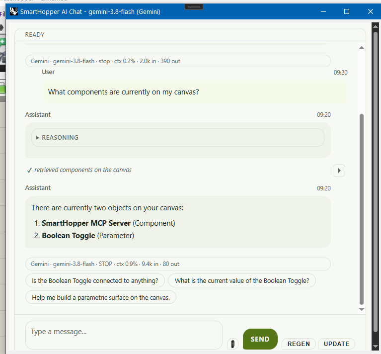
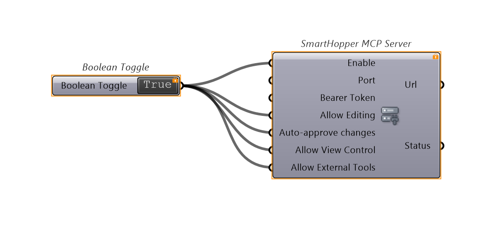
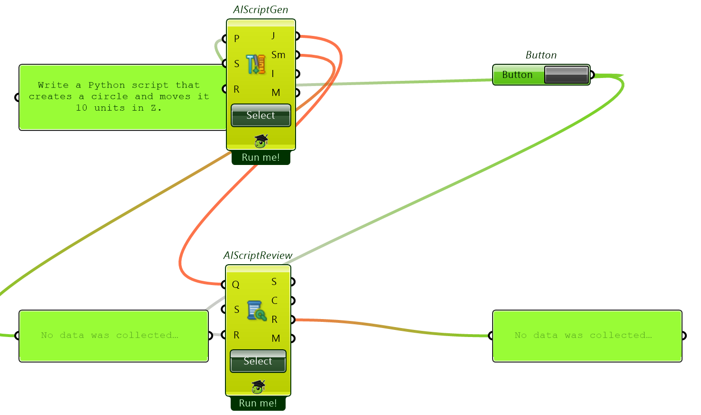
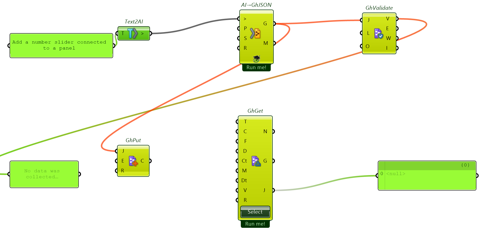
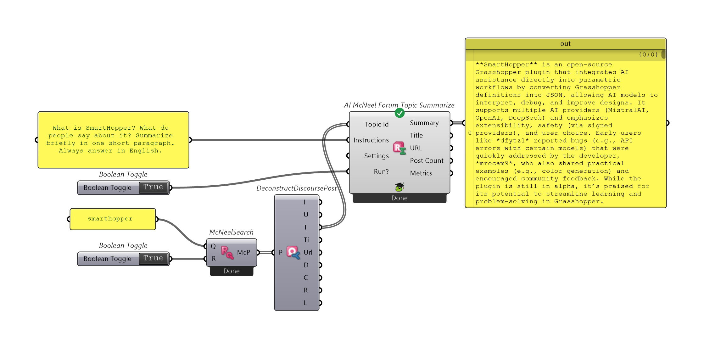
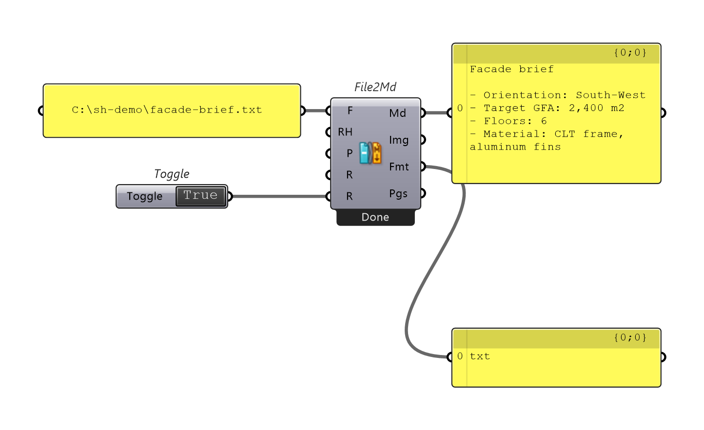
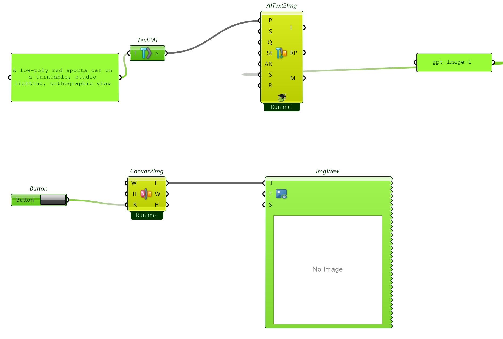
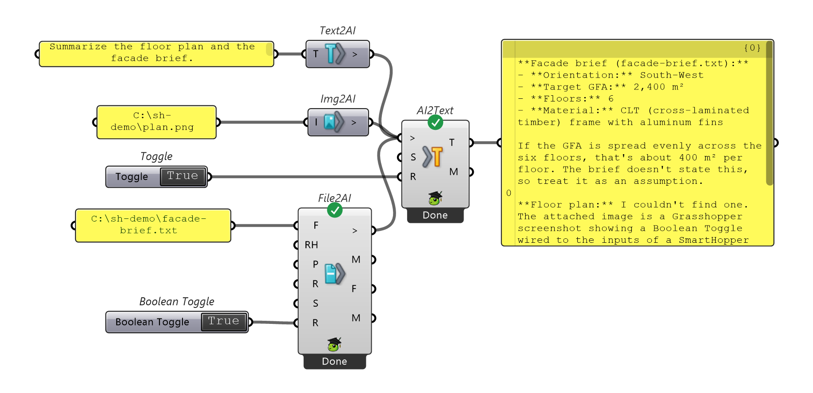
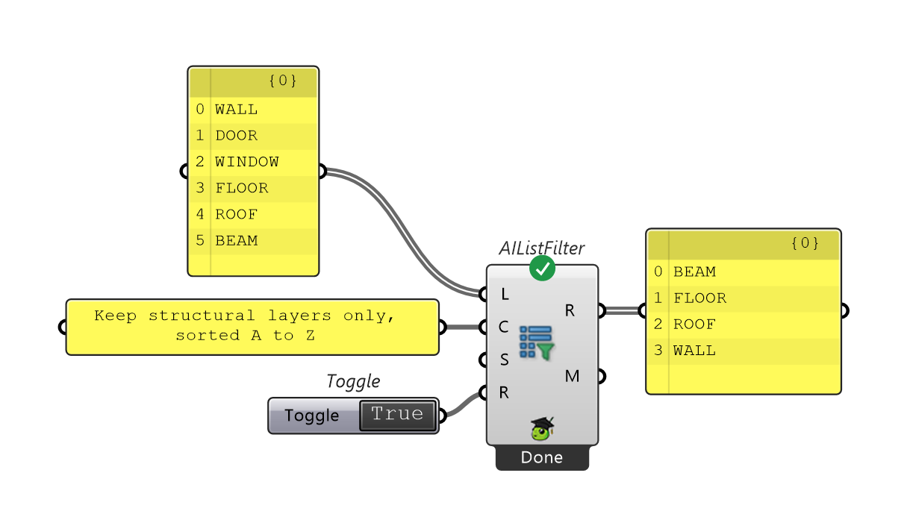
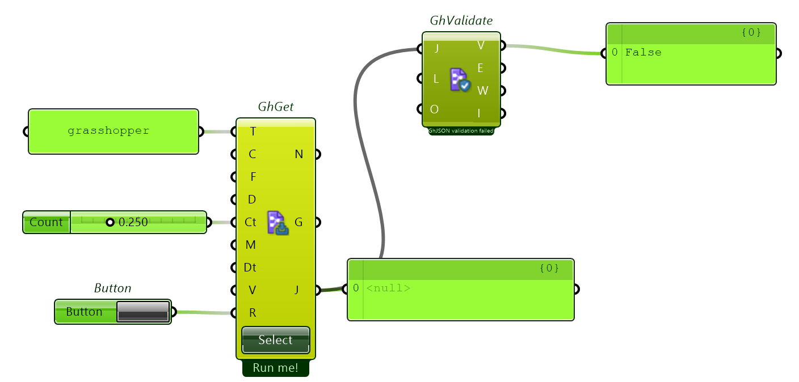

# SmartHopper - AI-Powered Tools and Assistant for Grasshopper3D

[](https://github.com/architects-toolkit/SmartHopper/releases)
[](https://github.com/architects-toolkit/SmartHopper/releases)
[](https://github.com/architects-toolkit/SmartHopper/actions/workflows/ci-dotnet-tests.yml)
[](https://smarthopper.xyz/#install)
[](https://github.com/architects-toolkit/SmartHopper/blob/main/LICENSE)
[](https://deepwiki.com/architects-toolkit/SmartHopper)

> **Are you looking for a stable version?** Visit our webpage at **[smarthopper.xyz](https://smarthopper.xyz)** to get the latest stable release.

<div align="center">

[](https://smarthopper.xyz)

**Open-source AI for Grasshopper 3D that keeps you in control.**

Embed AI directly inside your definitions with **native parametric components**, work alongside a **customizable agentic canvas assistant**, or connect **Claude, Codex, Cursor, and VS Code** through the **built-in MCP server** — with staged diff reviews, `Ctrl+Z` undo, and your choice of cloud or offline local models.

<!-- markdownlint-disable-next-line MD036 -->
**80+ AI tools · 90+ Grasshopper components · 8 AI providers · MCP Server**

</div>

---

## Why SmartHopper?

- **Native parametric components — AI inside your data flow, not just on top of it.** Most AI tools only talk to the canvas from the outside. SmartHopper gives you composable Grasshopper components (`Text to AI`, `Image to AI`, `File to AI` → `AI to Number`, `AI to Boolean`, `AI to JSON`, `AI to Script`, and more) that live inside your data trees and output native Grasshopper types without fragile string parsing.
- **Staged canvas review and `Ctrl+Z` undo.** When the assistant or an external agent proposes changes to your definition, you inspect and approve every addition, wire, or modification before it lands on the canvas — and `Ctrl+Z` undoes it like any manual edit.
- **Plain-text definitions with [GhJSON](https://github.com/architects-toolkit/ghjson-spec).** SmartHopper created and uses GhJSON (`.ghjson`) and GhPatch (`.ghpatch`) — open, human-readable JSON formats for Grasshopper definitions and surgical diffs that work cleanly with AI models and Git version control.
- **Your providers, your keys, your privacy.** Connect OpenAI, Anthropic, Google Gemini, MistralAI, DeepSeek, or OpenRouter with OS-encrypted API keys, or run 100% offline and free on your workstation with Ollama or LocalAI.

## Three ways to work

### 1. Native parametric components (`Input → Output`)

When you want AI embedded inside a parametric definition, chain an **Input** component into an **Output** component:

```text
[Your data] ──► [Input component] ──(Input >)──► [Output component] ──► [Typed Grasshopper data]
                 (Text2AI, Img2AI,                (AI→Text, AI→Num,
                  File2AI, Web2AI…)                AI→Bool, AI→JSON…)
```

Any input component connects to any output component, and you can merge multiple inputs (such as a prompt, a screenshot, and a PDF) into a single AI call. For common single-step tasks, SmartHopper also includes ready-made components such as **AI Text To Text**, **AI List Filter**, **AI Text To Image**, and **AI Script Generate**.


### 2. Customizable agentic canvas assistant (`AI Chat`)

Click the **SmartHopper** button on the Grasshopper canvas (or drop an **AI Chat** component into your file) to open an interactive agentic assistant with customizable system instructions and access to 80+ AI tools. It can read your selected components, diagnose runtime errors, look up solutions on the McNeel and Ladybug forums, write or review script components, and stage edits to your definition that you review item by item before applying.



### 3. Built-in MCP server for external agents

Start the **SmartHopper MCP Server** component to expose your canvas over a local, token-protected Model Context Protocol endpoint. External agents such as **Claude Desktop, Claude Code, OpenAI Codex, Cursor, or VS Code** can inspect your definition and (when you allow it) propose canvas edits through the same reviewed, undo-safe tool pipeline.



## Key capabilities

- **Wire AI into your definition with native Grasshopper types.** Wrap inputs (`Text to AI`, `Image to AI`, `File to AI`, `Web to AI`, `Canvas to AI`) and extract typed outputs (`AI to Text`, `AI to Number`, `AI to Boolean`, `AI to JSON`, `AI to GhJSON`, `AI to Image`, `AI to Speech`, `AI to Script`) that plug straight into standard Grasshopper parameters.
- **Generate, edit, and review scripts.** Describe what you need in Python, C#, VB.NET, or IronPython and get a ready-to-run script component with inputs, outputs, and code — or run a static AI review on an existing script.
- **Bring documents, web pages, and forum threads into Grasshopper.** Convert PDFs, Word docs, spreadsheets, emails, and web pages to clean Markdown, or search and summarize threads from the McNeel Discourse forum, the Ladybug Tools forum, or any Discourse community.
- **Inspect, tidy, diff, and patch definitions.** Let AI diagnose runtime errors, group and align messy graphs, or apply `.ghpatch` diffs to update existing definitions in place.
- **Multimodal vision and audio.** Analyze viewport or canvas screenshots, generate reference images, transcribe speech to text, or synthesize audio directly inside Grasshopper.

## Component gallery

| Generate and place scripts | Prompt → GhJSON, validated and placed |
| --- | --- |
|  |  |

| Forum threads summarized as context | Files and web pages to Markdown |
| --- | --- |
|  |  |

| Canvas and image understanding | Merge prompt, image and file into one call |
| --- | --- |
|  |  |

| Natural-language list filtering | Read and validate the active document |
| --- | --- |
|  |  |

## AI providers

SmartHopper works with the providers you already use. Pick a global default in **SmartHopper → Settings**, or right-click any AI component to pin it to a specific provider. See the [provider setup guides](https://docs.smarthopper.xyz/docs/providers) and the [feature matrix](DEV.md#%E2%9E%A1%EF%B8%8F-available-providers) for model capabilities.

### Cloud providers (API key)

-  [MistralAI](https://mistral.ai/)
-  [OpenAI](https://openai.com/)
-  [DeepSeek](https://deepseek.com/)
-  [Anthropic](https://anthropic.com/)
-  [OpenRouter](https://openrouter.ai/) — multi-vendor gateway behind a single key
-  [Google Gemini](https://ai.google.dev/)

### Local providers (free & private on your machine)

-  [Ollama](https://ollama.com/) — local server, no API key required
-  [LocalAI](https://localai.io/) — self-hosted, OpenAI-compatible

## Installation & quick start

### Requirements

- **Rhino 8.0 or newer** on Windows or macOS
- An API key for at least one cloud provider, or a local [Ollama](https://ollama.com/) / [LocalAI](https://localai.io/) server

### Install

- **Rhino Package Manager (recommended):** Run `PackageManager` in Rhino, search for **SmartHopper**, and click **Install** (check *Include pre-releases* if you want the latest preview build).
- **Food4Rhino:** Install from the [SmartHopper page on Food4Rhino](https://www.food4rhino.com/en/app/smarthopper).
- **Manual (development builds):** Download the latest archive from [GitHub Releases](https://github.com/architects-toolkit/SmartHopper/releases), extract it into your Grasshopper *Components Folder* (*File → Special Folders → Components Folder*), and unblock the files if prompted by your OS.

### Get running in two minutes

1. Restart Rhino and open Grasshopper.
2. Open **SmartHopper → Settings** in the Grasshopper menu bar, click your provider's tile on the **General** tab to paste an API key (or point to your local server), and select your **Default AI provider**.
3. Click the **SmartHopper** button on the canvas to chat with the assistant, or drop **Text to AI** → **AI to Text** onto the canvas and set **Run?** to `True`.

## Documentation

Full documentation lives at **[docs.smarthopper.xyz](https://docs.smarthopper.xyz)** — including the [User Guide](https://docs.smarthopper.xyz/docs/intro), [Component Library](https://docs.smarthopper.xyz/docs/components), [AI Tools Library](https://docs.smarthopper.xyz/docs/ai-tools) and [Developer Guide](https://docs.smarthopper.xyz/docs/developer/overview) (see also the in-repo [`/docs`](docs/Architecture.md) reference). [Video walkthroughs](https://docs.smarthopper.xyz/docs/videos) are also available — they were recorded on a previous version; updated videos are coming soon.

## Contributing

Every great innovation starts with a single contribution. Whether you're a designer, developer, or AI enthusiast, your unique perspective can help shape the future of computational design tools.

Please see our [Contributing Guidelines](CONTRIBUTING.md) for details on how to contribute to this project.

## Changelog

See [Releases](https://github.com/architects-toolkit/SmartHopper/releases) for a list of changes and updates.

## License

This project is licensed under the GNU Lesser General Public License v3 (LGPL) - see the [LICENSE](LICENSE) file for details.

## Trademark and Logo Usage Policy

The SmartHopper name and logo are the property of the SmartHopper / architects-toolkit maintainers. The LGPL v3 license under which the source code is distributed does **not** grant rights in the SmartHopper name or logo.

We allow use of the SmartHopper name and logo in the following contexts:

- In blog posts, articles, tutorials, talks, or reviews that discuss or promote SmartHopper, provided the usage is accurate, fair, and does not imply endorsement by the SmartHopper maintainers.
- In educational materials, courses, or presentations that accurately represent the project.
- When referring to the unmodified, official SmartHopper plug-in as installed from the Rhino Package Manager.

Please refrain from using the SmartHopper name and logo:

- In promotional materials for paid services or commercial products that bundle, redistribute, or extend SmartHopper, without prior written permission.
- In a manner that may cause confusion about the origin of a product or imply endorsement.
- On forks, derivative works, or paid offerings derived from the SmartHopper source code — please choose a distinct name and logo for your fork, as is common open-source trademark practice.

If you have any questions or wish to seek permission for other uses, please open an issue on this repository or contact the maintainers via [smarthopper.xyz](https://smarthopper.xyz).

Thank you for your understanding and cooperation.

---

<div align="center">
Started in Barcelona — spread worldwide    •    <a href="https://smarthopper.xyz">smarthopper.xyz</a>
</div>
